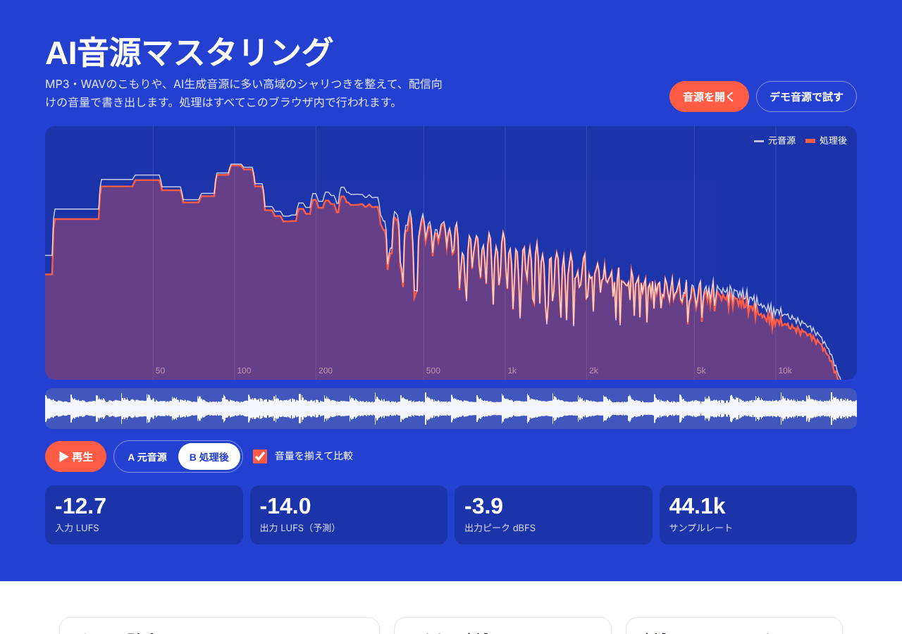

# AI Mastering Studio

**MP3・WAVのこもりや、AI生成音楽に多い高域のシャリつきを整えて、配信向けの音量で書き出すマスタリングツール。ブラウザーだけで動きます。**
A browser-only mastering tool tuned for the typical flaws of AI-generated music. [English below ↓](#english)

▶ **今すぐ使う：https://reekoby.github.io/ai-mastering-studio/**（インストール不要・無料）

---

## できること

- **自動診断**：曲全体のスペクトルを測り、こもり帯域の盛り上がり、中高域の刺さり、高域の欠け、MP3由来の帯域カット、ステレオの広さ、ラウドネスを表示。ボタンひとつで設定に反映
- **こもり除去**：200〜400Hzあたりに溜まった音を、帯域と量を選んで削る
- **AIのシャリつき抑制**：高域だけを分けてダイナミックに抑えるので、ジュワジュワした金属的なざらつきが鳴った瞬間だけ下がり、抜けは残る
- **空気感・低域・ステレオ**：12kHzシェルフ、ローカット、低域シェルフ、低域モノ化（M/S）、ステレオ幅
- **質感とまとまり**：倍音付加（ソフトサチュレーション）とグルーコンプ
- **ラウドネス**：ITU-R BS.1770 準拠のLUFS測定、先読みリミッター。全曲を測り直して目標LUFSとピーク上限に合わせる
- **聴き比べ**：処理前後を同期再生し、A/B切り替え。音量を揃えた比較が標準（大きいほうが良く聴こえる錯覚を防ぐ）
- **スペクトル表示**：処理前後を重ねて表示
- **ジャンル別プリセット**：J-POP、アニソン・ボカロ、ロック、メタル、EDM・ダンス、ヒップホップ、R&B・ソウル、バラード、アコースティック、ジャズ、クラシック・オーケストラ、Lo-fi・チル、アンビエントの13種類。ワンタップでバランスと目標ラウドネスを合わせ、自動診断の結果（こもりの帯域・量、高域の欠け）で曲ごとに補正
- **用途別プリセット**：AIこもり除去（標準）、ナチュラル、ボーカルを前に、強めの音圧、音量合わせのみ
- **書き出し**：WAV 24bit／16bit（TPDFディザ付き）、MP3 320kbps／192kbps

## 使い方

1. https://reekoby.github.io/ai-mastering-studio/ を開く（Chrome・Edge・Safari の最新版）
2. 「音源を開く」でMP3/WAVを読み込む（ドロップでも可）。まず「デモ音源で試す」で動作を確認できます
3. ジャンル別プリセットから曲のジャンルを選ぶ（または「診断結果を設定に反映」）→ 必要なら各つまみで調整。波形をタップするとプレビュー区間（24秒ループ）を移動できます
4. 形式（WAV／MP3）を選んで「書き出す」

**オフラインで使う**：[`index.html`](index.html) をダウンロードしてブラウザーで開くだけで動きます（書体の読み込みのみネット接続が必要）。

## プライバシー

音源の読み込み・解析・処理・書き出しはすべてブラウザー内で行われます。音声データはどこにも送信されません。

## 注意

- MP3などで失われた高い帯域（16kHz以上など）は復元できません。空気感の補正で聴感上の抜けを改善します
- 書き出しのサンプルレートは、ブラウザーが音源をデコードしたレート（多くは44.1kHzか48kHz）になります
- 長い曲は処理中に数秒〜数十秒画面が止まることがあります

## 処理の流れ

ローカット → 低域シェルフ → こもりカット（ピーキング）→ 明瞭感（3kHz）→ 高域を4次クロスオーバーで分割してダイナミック抑制 → 空気感（12kHzシェルフ）→ 倍音 → M/S（低域モノ化・幅）→ グルーコンプ → ゲイン → 先読みブリックウォール・リミッター

本体はライブラリ不要の1ファイル（`index.html`）です。MP3書き出しを使うときだけ、エンコーダー [lamejs](https://github.com/zhuker/lamejs)（LGPL-3.0）をCDNから読み込みます（[THIRD_PARTY_NOTICES.md](THIRD_PARTY_NOTICES.md)）。

**オフライン時の注意**：MP3書き出しにはネット接続が必要です（WAVは不要）。

---

## English

AI Mastering Studio cleans up the mud and the harsh, swirly top end that AI music generators tend to produce, then brings the track to a streaming-ready loudness, all inside the browser.

- Auto analysis of the whole track: low-mid buildup, harsh upper mids, missing highs, MP3 band cutoff, stereo width, loudness
- Low-mid "mud" cut, a dynamic high-band suppressor for AI shimmer, air shelf, low cut, mono bass (M/S), width, saturation and glue compression
- BS.1770 loudness measurement and a look-ahead limiter; the export re-measures the whole song to hit the target LUFS and ceiling
- Synced, loudness-matched A/B, before/after spectrum
- 13 genre presets (J-POP, anime/Vocaloid, rock, metal, EDM, hip-hop, R&B, ballad, acoustic, jazz, classical, lo-fi, ambient), optionally adjusted by the track's own analysis
- WAV export (24-bit, or 16-bit with TPDF dither) and MP3 export (320/192 kbps, via lamejs loaded on demand)

Use it at https://reekoby.github.io/ai-mastering-studio/ or download `index.html` and open it locally. No audio ever leaves your device.

## License

[MIT](LICENSE) © 2026 ΛNTRΞC
